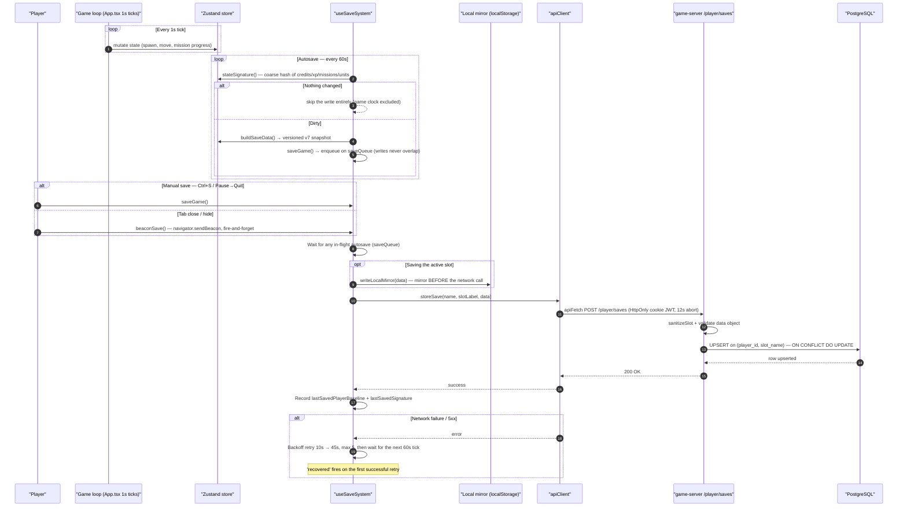
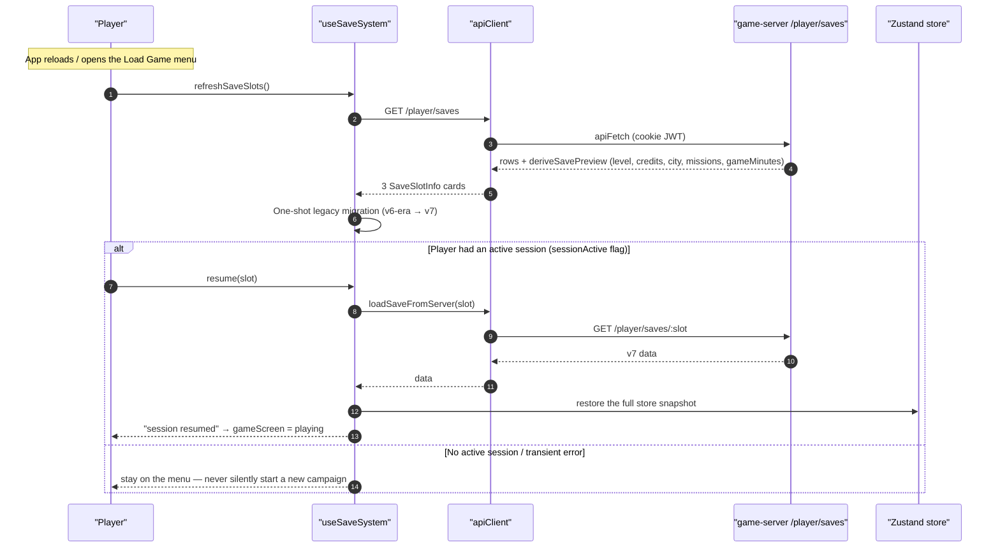
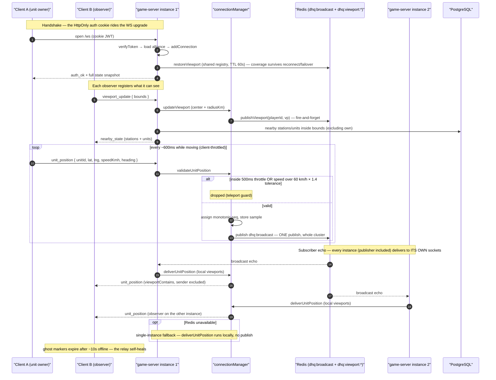
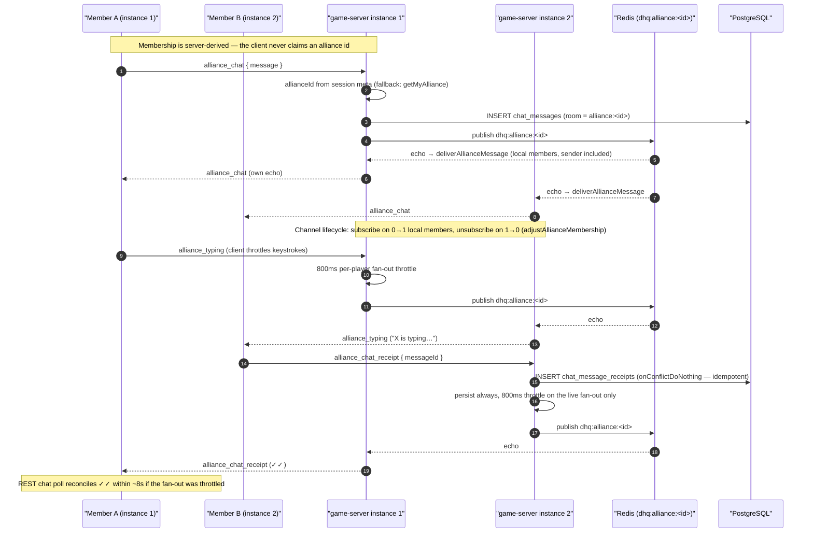
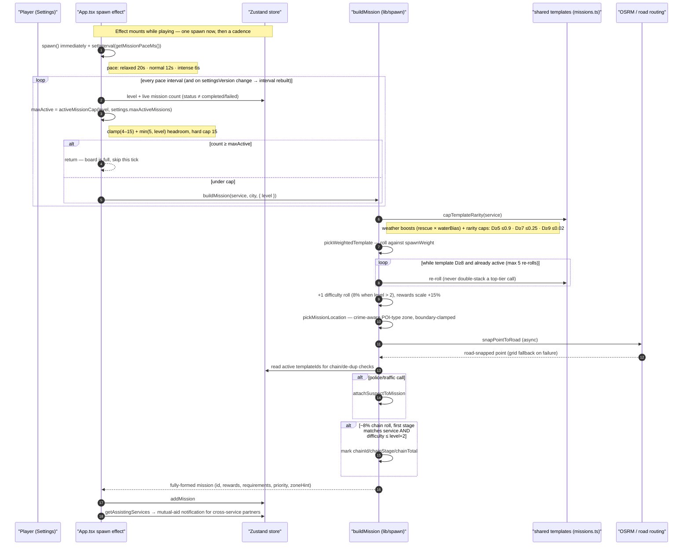

# Dispatch HQ — Architecture

## Overview

Dispatch HQ is a **pnpm + Turborepo monorepo** with four workspaces. The game is
**client-authoritative**: the React client runs the full simulation (spawn,
movement, missions, economy) and persists its state to the server. The server is
the source of truth for identity, saves, chat, leaderboards, alliances, and
admin actions, and relays live multiplayer state (unit positions, presence,
alliance chat) over WebSocket + Redis pub/sub.

```
┌─────────────────────────────┐        REST (auth, saves, stats, chat, …)
│  apps/web  (React client)   │ ─────────────────────────────────┐
│  simulation + Zustand store │                                   ▼
└──────────┬──────────────────┘                          ┌──────────────────┐
           │ WebSocket (positions, presence, chat)       │ servers/game-    │
           └───────────────────────────────────────────► │ server (Hono)    │
                                                        └───────┬──────────┘
                                                                │ Drizzle ORM
                                                   ┌────────────┴────────────┐
                                                   ▼                         ▼
                                           PostgreSQL               Redis (pub/sub,
                                           (players, saves,          viewport registry,
                                            chat, alliances,         per-alliance chat
                                            promos, audit)           channels)
```

## Workspaces

### `apps/web` — the game client
- **Stack:** React 19, Vite 6, TypeScript, Zustand, MapLibre GL (`react-map-gl`), Tailwind CSS, framer-motion, lucide-react.
- **Entry:** `src/main.tsx` → `App.tsx` (the game loop), `src/stores/gameStore.ts` (all simulation state).
- **The game loop** lives in `App.tsx` as a set of intervals that read fresh store state every tick:
  - *Spawn interval* — mission pacing (`20s/12s/6s` by setting), capped by `activeMissionCap(level, max)`.
  - *Station interval (1s)* — available/returning/patrolling unit behavior, patrol shifts, jail/hospital lifecycle.
  - *Game loop (1000/gameSpeed)* — mission progress, en-route unit movement, rewards, disasters.
- **Key subsystems** (all under `src/`):
  - `lib/spawn.ts` — the only place missions are constructed (`buildMission`).
  - `lib/dispatchLogic.ts`, `lib/patrol/*`, `lib/fieldActivities.ts`, `lib/disasters.ts`, `lib/weather.ts`, `lib/gameClock.ts` — gameplay systems.
  - `lib/agencies.ts`, `lib/justice.ts`, `lib/employees.ts` — service pipelines (hospital / jail / investigations / crews).
  - `lib/apiClient.ts` + `lib/wsClient.ts` — server communication.
  - `hooks/useSaveSystem.ts` — save v7 (three slots, autosave, local mirror, resume-on-reload).
- **City data:** `src/data/` — West Memphis boundary/streets, city zones.

### `packages/shared` — single source of truth
Pure TypeScript (no runtime deps beyond zod): types (`mission`, `unit`, `station`, `player`, `events`, `employee`, `justice`), constants (mission templates, unit configs, economy/XP curve, career ranks, alliance levels, mission tiers, chain definitions), and utils (ISO-week keys). Imported by both client and server as source TS (`exports: "./src/index.ts"`).

### `packages/game-engine` — simulation engine logic
Currently thin (spawn/mission systems + tests); most simulation lives client-side.

### `servers/game-server` — the backend
- **Stack:** Hono, `@hono/node-server`, Drizzle ORM (PostgreSQL), ioredis, jose (JWT), zod.
- **Entrypoints:**
  - `src/serve-combined.ts` — **production**: serves the built web app statically + API + WebSocket on one port (3001). CORS allowlist + per-IP rate limiting live here.
  - `src/index.ts` — dev entrypoint (no static serving, fewer hardening guards — keep in sync when touching middleware).
- **Auth:** JWT (HS256, issuer/audience pinned) in an HttpOnly, `SameSite=Strict` cookie, 30-day lifetime. Passwords: scrypt + per-user salt, `timingSafeEqual`.
- **Routes:** auth (register/login/guest/upgrade), player + stats, settings, saves (3 slots), stations/units/missions, chat, social (friends), leaderboard, achievements, bug reports, alliances, promo codes, admin (founder-gated).
- **WebSocket (`src/websocket/`):** token-validated handshake, `auth_ok` state snapshot, `unit_position` relay (throttle + speed-cap validation in `unitPosition.ts`), viewport fan-out, alliance chat with read receipts + typing, presence. `actionHandler.ts` runs server-authoritative economy actions (build/upgrade/buy/dispatch) with ownership + credit checks.
- **Redis (`src/lib/pubsub.ts`):** cluster-wide broadcast channel, per-alliance chat channels, shared viewport registry. Falls back to in-memory single-instance mode when Redis is down.

## Key data flows

1. **Identity & persistence:** login/guest → cookie JWT → saves/settings/stats keyed to `playerId` from the token. The client pushes cumulative career stats; the server upserts with monotonic `GREATEST` semantics.
2. **Live multiplayer:** the client streams throttled `unit_position` messages (600ms client, 500ms server throttle, 60 km/h cap). The server validates, assigns a monotonic `seq`, and publishes to Redis; every instance delivers to its own viewport-covered players. Alliance chat flows over `dhq:alliance:<id>` channels; read receipts + typing are throttled per player.
3. **Admin grants / promos:** founder/back-office writes land directly on the player row; the client polls `/me` every 30s (and on window focus), diffs against the last-saved baseline, and adds positive deltas onto live state (never clobbering local progress).
4. **Leaderboards:** server-side `player_stats` + `players` rows (level-first lifetime XP since v0.19), weekly snapshots in `player_settings` jsonb, friends + alliance boards.

## Save lifecycle (save v7)

The client is authoritative for game state, so saving is a **snapshot-and-persist** flow: every write serializes the entire Zustand store into a versioned payload, mirrors it locally, and upserts it to the server. On reload, the app restores the snapshot and resumes the session — it never silently starts a new campaign. The two diagrams below cover the write path and the resume path; the ASCII overview at the end ties them together.

### Write path — `buildSaveData()` → `storeSave()`



Key mechanics:
- **One writer.** All entry points funnel through `saveGame()`, which serializes on a module-level `saveQueue` promise chain — a manual save waits for an in-flight autosave.
- **Mirror first.** `writeLocalMirror` persists the browser copy *before* the network call (active slot only), so offline progress is never lost.
- **Idempotent server write.** The route sanitizes the slot (trim/lowercase/50-char cap), validates the data object, then upserts `ON CONFLICT DO UPDATE` on `(player_id, slot_name)` — repeated writes never duplicate rows.
- **Failure policy.** A failed save reports once, retries at 10s → 45s, and gives up after 5 consecutive failures until the next 60s tick; the first successful retry fires `recovered`.

### Load menu & resume-on-reload



Key mechanics:
- **Slot previews are cheap.** The server derives the preview (`level`, `credits`, `city`, `missionsCompleted`, …) straight off the jsonb with numeric guards — no per-slot fetches on the menu.
- **Resume is opt-in.** Reloading lands on the menu unless a session was marked active; explicit exits (Quit, Logout, New Campaign) clear the flag. Any transient error leaves you on the menu rather than dropping into a fresh game.
- **Legacy migration** runs once on the first server response that lacks v7 markers.

### End-to-end overview (ASCII)

```
SAVE WRITE PATH  (every successful save also anchors the /me reconcile baseline)

 Game loop        60s dirty-check       useSaveSystem        buildSaveData()     Zustand
 (1s ticks) ───────────────────────►  saveGame()  ──────────────────────────────► store
  mutates store                       │  serialized on saveQueue                  (snapshot)
                                      │
                                      ├──► localStorage mirror (active slot, before network)
                                      ▼
                              apiClient.storeSave ──POST /player/saves──► game-server
                                                                           │ sanitizeSlot + validate
                                                                           ▼
                                                                   UPSERT (player_id, slot_name)
                                                                   ON CONFLICT DO UPDATE
                                                                           │ 200
                                      ◄────────────── success ──────────────────┘
                                      │
                                      ├─► lastSavedSignature      (skip next autosave)
                                      └─► lastSavedPlayerBaseline (anchor for /me diff)

RESUME-ON-RELOAD

 App reload ──► sessionActive? ──yes──► GET /player/saves/:slot ──► restore store ──► playing
                  │
                  └──no──► Load menu (slot cards from deriveSavePreview)

RECONCILE  (30s poll + window focus — pairs with saves via the baseline)

 GET /me ──► diff server row vs lastSavedPlayerBaseline ──► add positive deltas
 (admin grants, promos from another device) on top of live state, re-level, update baseline
```

Every successful save re-anchors `lastSavedPlayerBaseline`, which the 30-second `/me` poll diffs against — so server-side grants are layered *on top of* live progress on the next reconcile, never clobbering it. The two systems share that anchor and are deliberately complementary.

### Server side — `routes/saves.ts` (`/api/player/saves`)

Mounted identically in both entrypoints (`app.route('/api/player/saves', saveRoutes)` — `index.ts:55`, `serve-combined.ts:128`). Every handler reads `playerId` from the verified JWT cookie (`AuthVars`) and scopes all queries with it — the slot name and payload never carry identity, so there is no path to read or write another player's saves.

| Method | Path | Purpose |
|---|---|---|
| `GET` | `/` | List this player's slots + derived previews (Load Game menu) |
| `POST` | `/` | Upsert a slot's full payload |
| `GET` | `/:slot` | Fetch one slot's payload (resume-on-reload) |
| `DELETE` | `/:slot` | Delete a slot |

**Schema** (`db/schema.ts` — `player_saves`): `player_id` (FK → players) + `slot_name` (varchar 50) with a **unique index on `(player_id, slot_name)`** — that pair *is* the upsert key. `data` is a single `jsonb` blob holding the entire v7 client snapshot; the server never interprets or merges it (the client is authoritative). `label` is a display name (varchar 100); `created_at`/`updated_at` are timestamptz.

**Slot sanitization** (`sanitizeSlot`): `String(slot ?? '').trim().toLowerCase().slice(0, 50)` — applied to the body field *and* the path param. Coercion happens first (the v0.17.6 error log caught `TypeError: slot.trim is not a function` 400ing save requests after a numeric slot), then trim/lowercase (so `/:slot` of `DEFAULT` and `default` hit the same row), then a 50-char cap matching the column. Empty after sanitize → `400 Missing slot name`.

**POST — upsert semantics** (`onConflictDoUpdate`):
- Validates the JSON body (400), a non-empty slot (400), and that `data` is an object (400).
- `label` falls back to the slot name and is truncated to 100 chars.
- `INSERT … ON CONFLICT (player_id, slot_name) DO UPDATE SET label, data, updated_at = now` — a **full replace, not a merge**: the latest client snapshot wins wholesale. `created_at` survives overwrites; `updated_at` always bumps — which is what the client's recency ordering and the load-menu sort rely on. Repeated writes never duplicate rows, so the autosave/beacon/manual triple-write pattern is safe to replay.

**GET / (list)** selects `slot_name, label, updated_at, created_at, data` ordered by `updated_at` and derives each row's preview **in the same response** (`deriveSavePreview(r.data)`) — the Load Game menu needs exactly one round trip, no N+1 fetches.

**`deriveSavePreview`** reads headline stats straight off the jsonb: `level`, `credits`, `xp`, `city` (non-empty string name), `service` (string), `missionsCompleted` (career), `gameMinutes`. Every value is guarded by a `num()` helper (`typeof === 'number' && Number.isFinite`) or a string check, so malformed/legacy payloads degrade to defaults (`level 1`, `credits 0`, `city null`, …) instead of crashing the list. Its client-side twin `derivePreviewFromPayload` (useSaveSystem) produces the same shape for mirror previews.

**The 404 contract the client ladder depends on:** `GET /:slot` with no row returns `{ error: 'Save not found' }` (404). `apiClient.loadSave` matches that message case-insensitively and resolves **null** — the definitive-absence signal that lets `loadGame` return `'not-found'` (Continue falls through to a new campaign) rather than `'error'` (stay on the menu). Any other failure (5xx, proxies) still throws and becomes `'error'`.

**Ops notes:** the routes are authenticated (per-player) but not rate-limited — abuse is bounded by account, not IP. Writes are idempotent by construction (upsert).

### WebSocket multiplayer flow

One `/ws` endpoint (`wsServer.ts`), token-validated in `onOpen` before any message is accepted. Two flows worth diagramming: the **live unit-position relay** (with viewport fan-out) and **alliance chat** (with receipts + typing). Both publish once to Redis and let every instance deliver to its *own* sockets via the subscriber echo; without Redis they fall back to in-memory local fanout (single-instance mode).

#### Unit-position relay + viewport fan-out



Key mechanics:
- **Two throttle layers.** The client streams at ~600ms; the server re-checks a 500ms window (`THROTTLE_MS`) and a 60 km/h speed cap with 1.4× tolerance (`unitPosition.ts`) — a scripted client can't teleport units or flood the wire.
- **seq is per-instance.** It restarts at 1 if the unit's owner reconnects to another instance; clients treat equal-or-newer as fresh, so movement is never dropped.
- **Delivery is deliberately local.** Recipient selection uses each instance's *own* viewport map — no cross-instance viewport reads on the hot path. The shared registry (`dhq:viewport:<playerId>`, TTL 60s) is only for reconnect continuity.

#### Alliance chat, receipts + typing



Key mechanics:
- **Persist before fan-out.** A message/ack is written to PostgreSQL first (receipts with `onConflictDoNothing` so repeat acks are idempotent), then broadcast — a crash can't show a message that was never stored.
- **Throttles protect the wire, not the DB.** Receipts and typing are always persisted; only the Redis fan-out is throttled at 800ms/player. The chat poll reconciles ✓✓ within ~8s.
- **Presence:** every 10s the server broadcasts `presence` (online count + player list) to all connected sockets.

### Mission spawn pipeline

The board's lifeblood: one dedicated effect in `App.tsx` paces spawns, and every mission is constructed in `lib/spawn.ts` (`buildMission`). The diagram shows the full path from the pace timer to a mission landing on the board.



Key mechanics:
- **Pace vs cap are independent.** The pace timer controls *cadence* (`getMissionPaceMs`, re-read when `settingsVersion` bumps); `activeMissionCap` controls *board size* and is checked every tick, so a slow pace with a big cap still fills the board.
- **Weighted, weather-aware, rarity-capped picks.** `spawnWeight` drives frequency; storms boost rescue-class calls; D5+ weights are hard-capped so extreme missions stay rare no matter the pool.
- **Crime-aware placement is async.** `pickMissionLocation` picks a POI-type zone, clamps to the city boundary, then road-snaps via OSRM — which is why `buildMission` is a promise and the spawn effect awaits it.
- **Anti-exploit guards:** a D≥8 template already on the board is re-rolled (max 5), and chain seeds can't open above `level + 2`.

**Secondary spawners** (all separate intervals, same `buildMission` under the hood):
- **Traffic duties** — every ~25s, a 42% roll has a *patrolling* unit spot an incident; built from the traffic-duty template pool at the unit's location, deduped per unit for 60s (`DUTY_INTERVAL_MS`).
- **Police field activity** — every 22s (police service only): traffic stops, warrant checks, pursuits; escalations can spawn pursuit missions (`runPoliceFieldActivity`).
- **Disasters** — every 20s, `maybeTriggerDisaster` rolls against the frequency setting; on a hit, a 10–15 call wave spawns from the disaster zone, followed by a staggered recovery wave (`RECOVERY_WAVE`, `AFTERMATH_WINDOW_MS`).
